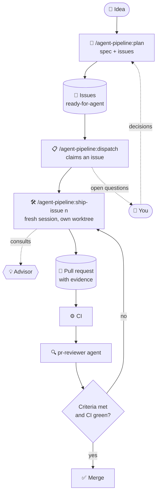
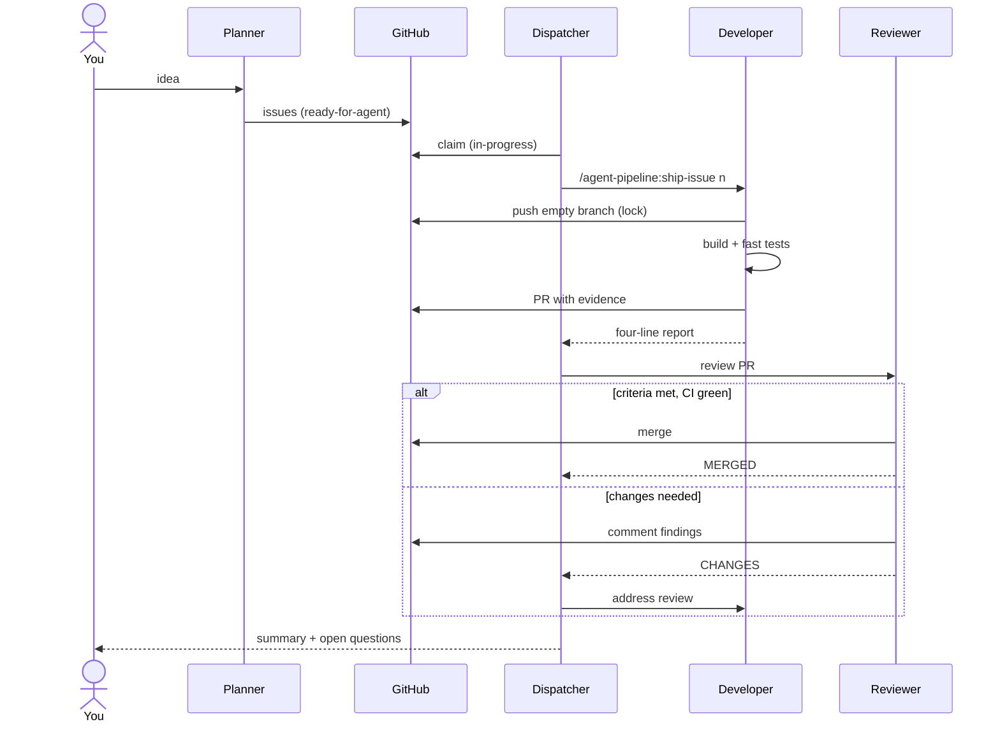

# Agent Pipeline

> A Claude Code plugin for shipping features with a small team of agents, using GitHub Issues as the message bus.

- **Plan.** An idea becomes small issues, each with checkable acceptance criteria.
- **Dispatch.** Each issue gets a fresh developer session in its own git worktree, and up to three run in parallel.
- **Build.** The developer opens a PR with its evidence and waits for CI.
- **Review.** A reviewer agent checks the issue's criteria and the project's rules, then merges on green CI.
- **You** make only the scope and design calls.



## Install

In a shell:

```bash
claude plugin marketplace add RyanFilho/agent-pipeline
claude plugin install agent-pipeline@agent-pipeline
```

Or inside a session, run `/plugin marketplace add RyanFilho/agent-pipeline`, then `/plugin install agent-pipeline@agent-pipeline`.

Updates arrive with `/plugin marketplace update agent-pipeline`, or automatically if you turn on auto-update for the marketplace in `/plugin`.

## Quick start

| Step | In a session | Result |
|---|---|---|
| 1. Prepare the project | `/agent-pipeline:adopt`, or ask *"prepare this project for the agent pipeline"* | a PR that adds the config, permissions, labels and issue templates |
| 2. Plan a feature | `/agent-pipeline:plan <idea>`, at your strongest model and high effort | a spec, plus issues labelled `ready-for-agent` |
| 3. Run the pipeline | `/agent-pipeline:dispatch`, at medium effort | developers start, PRs are reviewed and merged, and you get a summary table |

To triage existing issues instead of planning new ones, run `/agent-pipeline:plan 12 15 18`.

## What's inside

| Component | Role | Hands on |
|---|---|---|
| `/agent-pipeline:plan` | **Planner**: interviews you, writes the spec, slices it into issues | issues that are the whole brief |
| `/agent-pipeline:dispatch` | **Lead**: claims issues, starts developers, routes verdicts | a one-line prompt |
| `/agent-pipeline:ship-issue <n>` | **Developer**: builds one issue in a worktree, opens the PR | a PR body with evidence, and a four-line report |
| `agent-pipeline:pr-reviewer` | **Reviewer**: checks the spec and the standards, then merges | a one-line verdict |
| `/agent-pipeline:adopt` | **Setup**: prepares a repository | a PR |
| commit guard hook | refuses commits of local Claude config, and commits that introduce broken encoding | an error message Claude can act on |

## What `adopt` changes in a project

It inspects the repository, shows what it found, and asks once for anything it had to guess. Then, on a branch:

- **`.claude/agent-pipeline.md`**: the repository, merge method, build and test commands, the [workflow settings](#workflow-settings), labels, areas that must not run in parallel, and the project's gates. Every pipeline session reads it.
- **`.claude/settings.json`**:
  - permission allow and deny lists, so the pipeline runs without prompts but can never push to the default branch or force push
  - the advisor
  - the plugin, so teammates get it too
- **Labels**: `ready-for-agent`, `in-progress`, `needs-triage`, `needs-info`, `blocked`, `deferred`, `ready-for-human`, `type:`, `area:` and `P1` to `P3`, plus `verify-after-deploy` when that setting is on.
- **Issue templates** with *Acceptance criteria*, *Where in the code*, *Out of scope* and *Verify*, plus *Verify after deploy* when that setting is on.
- **`CLAUDE.md`**: the pipeline's rules. If the file is over about 200 lines, `adopt` offers to split it into path-scoped `.claude/rules/`.
- **CI**: suggested `paths-ignore` lines, so a change to agent config does not deploy.

It opens a PR and leaves the merge to you.

## Workflow settings

Three settings in `.claude/agent-pipeline.md` change how a developer works. Leave one out and it takes its default, which is how the pipeline behaved before the setting existed.

| Setting | Default | Alternative |
|---|---|---|
| **Test cadence** | `inner-loop`: build and fast tests while implementing, slow tests once at the end | `end-only`: nothing runs while implementing. The build, fast tests and slow tests run once each, in full, before the PR. A failure reruns only the failing tests, then the full set once more |
| **Visual QA** | `required`: each touched screen in every theme, at phone, tablet and desktop widths, recorded in the PR | `none`: no rendered checks, for a project with no UI or one that does not gate on them |
| **Verify after deploy** | `off`: every issue closes when its PR merges | `on`: an issue whose *Verify after deploy* section is filled in gets `Refs #<n>`, not `Fixes #<n>`. On merge the reviewer labels it `verify-after-deploy`, and it stays open |

A `verify-after-deploy` issue waits for someone, or a project skill, to run its check against the deployed app. If the check passes, close the issue with the evidence as a comment. If it fails, comment what it showed and swap the label for `needs-triage`. The dispatcher lists these issues at the end of each pass and never starts them.

## A request, end to end



## Why it is shaped like this

- **Small handoffs, not conversations.** Roles pass issues, PR bodies and one-line verdicts. No session ever reads another's transcript.
- **Fresh context per developer.** A developer is never forked from the lead: the issue is the brief. If the issue isn't enough, the fix is a better issue.
- **State lives in GitHub.** The lead can `/clear` at any time and rebuild its state from `gh`.
- **The lead never reads a diff.** The PR body and CI carry the evidence, and the reviewer reads the diff once, in its own context.
- **The advisor sits where it's cheap.** It re-reads the whole transcript on every call, so it belongs in short developer sessions, not in the long lead session.
- **Instructions load on demand.** A short `CLAUDE.md`, plus rules scoped to file paths.

## Guardrails

- 🔒 **Claim lock.** An issue gets `in-progress`, and its branch is pushed before any code is written, so a second session's preflight sees it.
- 🌳 **One worktree per developer.** Never the shared checkout. The skill checks, and moves itself into a worktree if it has to.
- 🚦 **Permissions.** Routine commands are allowed. Pushing to the default branch, force pushing and `--admin` merges are denied.
- ✅ **Merges.** Only on green CI, with the method the repository already uses.
- 🧵 **Serialised areas.** Two issues in an area such as migrations never run at once.

## Requirements

- A GitHub repository, with the [`gh` CLI](https://cli.github.com) signed in.
- **The Claude desktop app** for the automatic part: `/agent-pipeline:dispatch` starts developer sessions with the app's session tools. In a plain terminal, the dispatcher claims issues and tells you which ones to open. You then run `/agent-pipeline:ship-issue <n>` in a session per issue, each in its own git worktree.
- Node.js, for the commit guard and the setup scripts.
- Every pipeline session must use the same permission mode, or messages between sessions are not delivered.

## Lessons learned

| Problem | Fix |
|---|---|
| Two sessions built the same issue | claim label, plus a branch pushed before any code |
| The lead read every diff | evidence in the PR body, and one reviewer |
| The instruction file grew huge | split it into rules scoped by path |
| A developer started in the shared checkout | an explicit worktree, plus a self-check in the skill |
| A stale lead checkout handed out old instructions | fast-forward before each run |
| The reviewer could not "request changes" on its own PR | post a PR comment instead |
| `gh pr merge --delete-branch` failed | delete the remote branch separately, because a worktree still has it checked out |

## Layout

```text
.claude-plugin/   plugin.json, marketplace.json
skills/           plan, dispatch, ship-issue, adopt
agents/           pr-reviewer.md
hooks/            hooks.json, guard-commit.mjs
scripts/          merge-settings.mjs, split-claude-md.mjs
templates/        agent-pipeline.md, settings.json, labels.json, claude-md-section.md, ISSUE_TEMPLATE/,
                  verify-after-deploy-field.yml
```

**To change the workflow for everyone, edit the skills here.** Project-specific detail belongs in each project's `.claude/agent-pipeline.md`.
