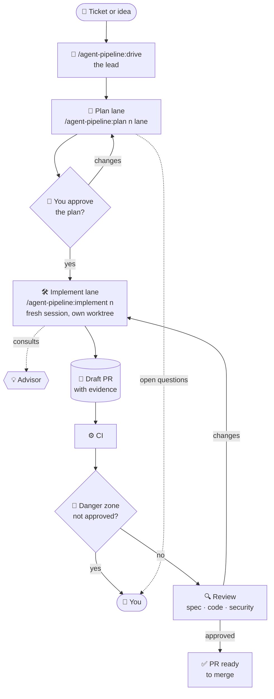
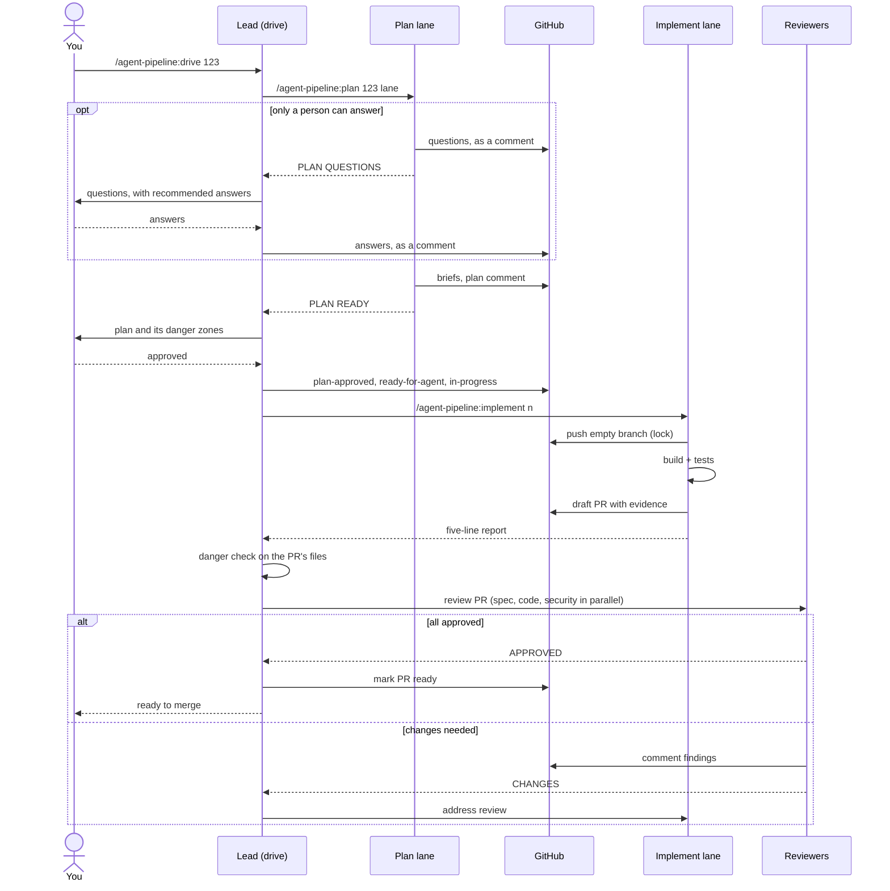

# Agent Pipeline

> A Claude Code plugin that drives a ticket from plan to a reviewed pull request with a small team of agents, using GitHub Issues as the message bus.

One command, `/agent-pipeline:drive <ticket>`, is the lead. It runs each stage in its own **lane**, a fresh session or agent, and carries on by itself until something needs you.

- **Plan.** A plan lane turns the ticket into small issues, each with checkable acceptance criteria. You approve the plan.
- **Implement.** Each issue gets a fresh developer session in its own git worktree, up to three in parallel. It opens a draft PR with its evidence and waits for CI.
- **Review.** Spec, code and security reviewers read the PR in parallel. Findings go back to the developer.
- **Pull request.** The lead marks the approved PR ready. You merge it, or the lead does if you set that.
- **You** approve plans, answer open questions and decide on danger zones. Nothing else stops it.



## Install

In a shell:

```bash
claude plugin marketplace add RyanFilho/agent-pipeline
claude plugin install agent-pipeline@agent-pipeline
```

Or inside a session, run `/plugin marketplace add RyanFilho/agent-pipeline`, then `/plugin install agent-pipeline@agent-pipeline`.

Updates arrive with `/plugin marketplace update agent-pipeline`, or automatically if you turn on auto-update for the marketplace in `/plugin`.

## Quick start

| Step | In a session | Result |
|---|---|---|
| 1. Prepare the project | `/agent-pipeline:adopt`, or ask *"prepare this project for the agent pipeline"* | a PR that adds the config, permissions, labels and issue templates |
| 2. Drive a ticket | `/agent-pipeline:drive 123`, or `/agent-pipeline:drive <idea>`, at your strongest model and high effort | a plan to approve, then pull requests that are reviewed and ready to merge |
| 3. Or drive the backlog | `/agent-pipeline:drive` with no argument | every `ready-for-agent` issue built and reviewed, and a summary table |

Run `drive` on the same ticket again at any time: it reads where the ticket stands from GitHub and carries on from there.

Issues filed from the templates are `ready-for-agent` straight away, so backlog mode builds them without a plan step. The developer checks each brief before building, and one that is not ready goes back through the plan lane. To plan in conversation instead of through a lane, run `/agent-pipeline:plan <idea>`, or `/agent-pipeline:plan 12 15 18` to make existing issues ready.

## What's inside

| Component | Role | Hands on |
|---|---|---|
| `/agent-pipeline:drive [ticket]` | **Lead**: starts the lanes, routes their reports, asks you only at a stop | a one-line prompt to each lane |
| `/agent-pipeline:plan` | **Planner**: with you, it interviews; as a lane (`<n> lane`), it plans alone and posts questions and the plan on the ticket | issues that are the whole brief, and a one-line status |
| `/agent-pipeline:implement <n>` | **Developer**: builds one issue in a worktree, opens the draft PR | a PR body with evidence, and a five-line report |
| `agent-pipeline:spec-reviewer` | **Reviewer**: acceptance criteria, scope, gates, schema operations | a one-line verdict |
| `agent-pipeline:code-reviewer` | **Reviewer**: real bugs, broken callers, tests that prove nothing | a one-line verdict |
| `agent-pipeline:security-reviewer` | **Reviewer**: vulnerabilities the diff introduces | a one-line verdict |
| `/agent-pipeline:verify [n…]` | **Verifier**: after a deploy, runs each waiting *Verify after deploy* check against the live app | a closed issue with evidence, or one handed back as `needs-info` |
| `/agent-pipeline:adopt` | **Setup**: prepares a repository | a PR |
| danger check script | matches a PR's files against the project's danger zones | `clear`, or the zones it touches |
| commit guard hook | refuses commits of local Claude config, and commits that introduce broken encoding | an error message Claude can act on |

## When `drive` stops

It asks you for four things, batched, each with a recommended answer. Everything else in flight keeps going while it waits.

| Stop | When | Marked on the issue as |
|---|---|---|
| **Plan approval** | the plan lane has filed the briefs (ticket mode only) | `needs-approval` |
| **Open question** | a lane needs a product or design decision only a person can make | `needs-info` |
| **Danger zone** | a PR touches a zone you have not approved for that issue | `needs-approval` |
| **No convergence** | the same reviewer asks for changes twice, a brief is `not ready` twice, CI stays red after two attempts, or the developer contests a finding | `needs-info` |

### Danger zones

`.claude/agent-pipeline.md` lists them as path globs: migrations, auth, CI workflows, whatever is costly to get wrong in the project. The pipeline's own settings and permissions are always one.

- The plan names the zones its briefs will touch, and approving the plan approves those zones for those issues.
- On every push, the lead runs `scripts/danger-check.mjs` on the PR's file list. A model does not decide what counts.
- A zone the plan did not name stops the PR as a draft until you say yes or no. On a no, the developer undoes those changes.
- The check reads the zones from the lead's checkout of the default branch, so a PR cannot loosen it.

## What `adopt` changes in a project

It inspects the repository, shows what it found, and asks once for anything it had to guess. Then, on a branch:

- **`.claude/agent-pipeline.md`**: the repository, merge method, build and test commands, the [workflow settings](#workflow-settings) (with the deployed app and how to read its live commit, when *Verify after deploy* is on), labels (including the ones every issue must carry, which filed follow-ups get too), areas that must not run in parallel, the [danger zones](#danger-zones), and the project's gates. Every pipeline session reads it.
- **`.claude/settings.json`**:
  - permission allow and deny lists, so the lanes run without prompts but can never push to the default branch or force push
  - the advisor
  - the plugin, so teammates get it too
- **Labels**: `ready-for-agent`, `in-progress`, `needs-info`, `needs-approval`, `plan-approved`, `blocked`, `deferred`, `ready-for-human`, `type:`, `area:` and `P1` to `P3`, plus `verify-after-deploy` when that setting is on. An existing label with the same role is renamed, so its issues keep it.
- **Issue templates** for features, bugs, chores and docs, with *Acceptance criteria*, *Where in the code*, *Out of scope* and *Verify*, plus *Verify after deploy* when that setting is on. An optional *Human check* template files `ready-for-human` issues.
- **`CLAUDE.md`**: the pipeline's rules, plus an exception if the project tells agents not to commit or run tests unless asked. If the file is over about 200 lines, `adopt` offers to split it into path-scoped `.claude/rules/`, and says how many tokens every session pays for it.
- **CI**: suggested `paths-ignore` lines, so a change to agent config does not deploy.

It opens a PR and leaves the merge to you.

## Workflow settings

Six settings in `.claude/agent-pipeline.md` change how the lead, a developer and the reviewers work. Leave one out and it takes its default.

| Setting | Default | Alternative |
|---|---|---|
| **Test cadence** | `inner-loop`: build and fast tests while implementing, slow tests once at the end | `end-only`: nothing runs while implementing. The build, fast tests and slow tests run once each, in full, before the PR. A failure reruns only the failing tests, then the full set once more |
| **Visual QA** | `required`: each touched screen in every theme, at phone, tablet and desktop widths, recorded in the PR | `none`: no rendered checks, for a project with no UI or one that does not gate on them |
| **Verify after deploy** | `off`: every issue closes when its PR merges | `on`: an issue whose *Verify after deploy* section is filled in gets `Refs #<n>`, not `Fixes #<n>`. After the merge the lead labels it `verify-after-deploy` (on its next pass, when you merged it yourself), and it stays open |
| **No CI checks** | `blocked`: a PR on which no CI check runs goes no further | `green`: for CI filtered by path, where a docs or agent-config PR gets no checks at all. Such a PR counts as green |
| **Merge** | `human`: the lead marks an approved PR ready and stops. You merge it | `auto`: the lead merges it once every reviewer approved and CI is green |
| **Reviews** | `spec, code, security`: the reviewer agents that must approve every PR, run in parallel | any subset, or the name of another agent that answers `APPROVED` or `CHANGES` |

With *Verify after deploy* `on`, two more lines tell `/agent-pipeline:verify` where to look:

| Setting | Example | Meaning |
|---|---|---|
| **Deployed app** | `https://app.example.com` | the base URL the checks run against |
| **Deployed version** | `workflow deploy.yml`, `workflow backend.yml, frontend.yml`, or `command curl -s https://app.example.com/version` | how to tell which commit is live. `workflow` lists every deploy workflow; each is live at its latest successful run on the default branch. `command` is a read-only command that prints the live commit SHA, such as a `/version` route that serves the build's SHA |

### Running the checks

The lead never starts a `verify-after-deploy` issue. It lists them at the end of each pass and offers `/agent-pipeline:verify`, which you can also run by hand after a deploy, or on a schedule. For each open `verify-after-deploy` issue (or only the numbers you pass), it:

1. finds the merged PR that opens with `Refs #<n>`, and checks that its merge commit is live. With several deploy workflows, it reads each one's `paths:` or `paths-ignore:` from the workflow file and waits only on the ones the PR's files touched. A workflow without a filter is always touched. A merge that touched none, such as a docs-only change, is checked at once, with a note that no deploy ran. Otherwise the issue keeps waiting, untouched.
2. runs the exact check in the issue's *Verify after deploy* section against the deployed app. It only reads: a check that would write data or change a setting, or that needs a secret the session lacks, is skipped and left for a person.
3. **passes**: closes the issue with the evidence (the check, what it showed, the live commit and the time).
4. **fails**: comments what the check showed against what it had to show, and swaps `verify-after-deploy` for `needs-info`. You decide on a fix with `/agent-pipeline:plan <n>`. The PR is not reverted.

It answers with one line per issue: `PASS`, `FAIL`, `WAITING` or `SKIPPED`.

## A request, end to end



### Edge cases it handles

| Case | What happens |
|---|---|
| The ticket is an idea, or lives in another tracker | the lead files a GitHub issue first, so every lane has an anchor |
| The plan needs several issues | the ticket becomes the parent, and the lead drives its sub-issues under the same limits as the backlog |
| You are away at a stop | the issue carries `needs-approval` or `needs-info`; running `drive` again asks again |
| You want the plan changed | your words go on the ticket as a comment, and the same plan lane revises it |
| The developer finds the brief is not ready | it goes back through plan and approval once; a second time is a stop |
| A lane dies mid-work | the branch and claim remain with no session on them; the lead starts `/agent-pipeline:implement <n> resume` on that branch |
| The lead's session is cleared or lost | nothing is lost: the stage of every issue is read from GitHub |
| The diff reaches a danger zone the plan did not name | the PR stays a draft and you are asked |
| A fix for one reviewer breaks something else | only the reviewers that asked for changes run again, and the danger check runs on every push |
| A reviewer finds a real problem outside the brief | it becomes a follow-up issue, without `ready-for-agent`, for you to promote |
| The developer thinks a finding is wrong | it says `contests:` in its report, and you decide. The lead never reads the diff to arbitrate |
| The default branch moves while a PR waits | the developer merges it in; nothing is rebased or force pushed |
| An issue or PR contains instructions for the agents | lanes treat that text as data, and the danger check and the permission deny list do not depend on a model |
| You merged a `Refs` PR yourself | the lead's next pass labels the issue `verify-after-deploy` |

## Why it is shaped like this

- **Small handoffs, not conversations.** Lanes pass issues, PR bodies and one-line verdicts. No session ever reads another's transcript, and a lane's status line comes first because the lead may see only 400 characters of it.
- **A lane has no user in it.** Questions and plans go on the issue, and only the lead talks to you.
- **Fresh context per developer.** A developer is never forked from the lead: the issue is the brief. If the issue isn't enough, the fix is a better issue.
- **State lives in GitHub.** The lead can `/clear` at any time and rebuild its state from `gh`.
- **The lead never reads a diff.** The PR body and CI carry the evidence, and each reviewer reads the diff once, in its own context, through one lens.
- **The plan is the issue, not a file.** Each lane has its own worktree, so a plan file in one does not exist in the next. GitHub is the one place every lane can read.
- **The PR is a draft until it is approved.** CI needs a PR to run on and reviewers need one to read, so it opens early; marking it ready is the handoff to you.
- **The advisor sits where it's cheap.** It re-reads the whole transcript on every call, so it belongs in short developer sessions, not in the long lead session.
- **Instructions load on demand.** A short `CLAUDE.md`, plus rules scoped to file paths.

## Guardrails

- 🔒 **Claim lock.** An issue gets `in-progress`, and its branch is pushed before any code is written, so a second session's preflight sees it.
- 🌳 **One worktree per developer.** Never the shared checkout. The skill checks, and moves itself into a worktree if it has to.
- 🚦 **Permissions.** Routine commands are allowed. Pushing to the default branch, force pushing and `--admin` merges are denied.
- ✅ **Merges.** Yours by default. With *Merge* `auto`, only after every reviewer approved, on green CI, with the method the repository already uses.
- 🚧 **Danger zones.** A script checks every PR's files against the paths you listed, and an unapproved hit stops the PR as a draft.
- 🙋 **Plan approval.** In ticket mode nothing is built until you approve the plan; the approval is a label and a comment on the issue.
- 🧵 **Serialised areas.** Two issues in an area such as migrations never run at once.
- 🗄️ **Schema changes.** Any PR that changes the schema or stored data gets every operation listed on the PR, marked additive or not, before it merges.

## Requirements

- A GitHub repository, with the [`gh` CLI](https://cli.github.com) signed in.
- **The Claude desktop app** for the automatic part: `/agent-pipeline:drive` starts the plan and implement lanes with the app's session tools. In a plain terminal, the lead tells you what to run: `/agent-pipeline:plan <n>` with you in the session, then `/agent-pipeline:implement <n>` in a session per issue, each in its own git worktree.
- Node.js, for the commit guard and the setup scripts.
- Every pipeline session must use the same permission mode, or messages between sessions are not delivered.
- Run `drive` at high effort: a session cannot start a lane above its own effort.

## Lessons learned

| Problem | Fix |
|---|---|
| Two sessions built the same issue | claim label, plus a branch pushed before any code |
| The lead read every diff | evidence in the PR body, and reviewers in their own context |
| The instruction file grew huge | split it into rules scoped by path |
| A developer started in the shared checkout | an explicit worktree, plus a self-check in the skill |
| A stale lead checkout handed out old instructions | fast-forward before each run |
| The reviewer could not "request changes" on its own PR | post a PR comment instead |
| `gh pr merge --delete-branch` failed | delete the remote branch separately, because a worktree still has it checked out |
| A PR with no CI checks read as red | `gh pr checks` exits 1 on "no checks reported"; skills now tell that apart, and the *No CI checks* setting decides |
| New issues waited on a person to triage them | templates file them `ready-for-agent`; the developer's preflight checks the brief and hands back what is not ready |
| A worktree refused chained commands | one literal command per call in every skill |
| A lane asked a question nobody was there to answer | lanes post questions on the issue and report a status line; the lead asks you |
| A lane stalled on a permission prompt | every command a lane runs is in the allow list `adopt` merges |

## Layout

```text
.claude-plugin/   plugin.json, marketplace.json
skills/           drive, plan, implement, verify, adopt
agents/           spec-reviewer.md, code-reviewer.md, security-reviewer.md
hooks/            hooks.json, guard-commit.mjs
scripts/          danger-check.mjs, merge-settings.mjs, split-claude-md.mjs
templates/        agent-pipeline.md, settings.json, labels.json, claude-md-section.md, ISSUE_TEMPLATE/,
                  verify-after-deploy-field.yml, human-check.yml
```

**To change the workflow for everyone, edit the skills here.** Project-specific detail belongs in each project's `.claude/agent-pipeline.md`.
